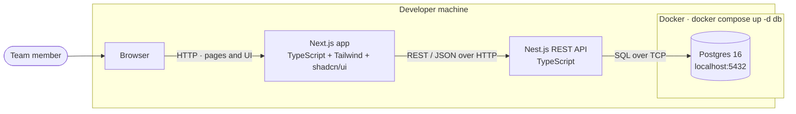
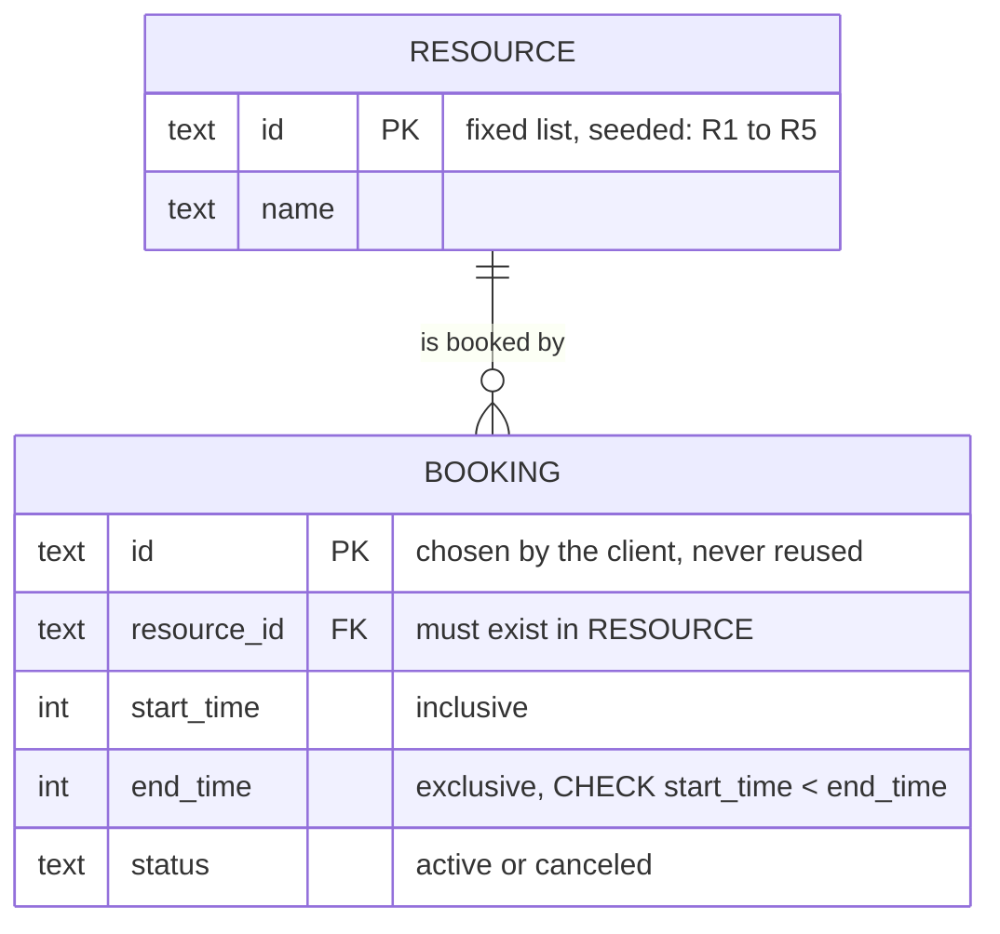
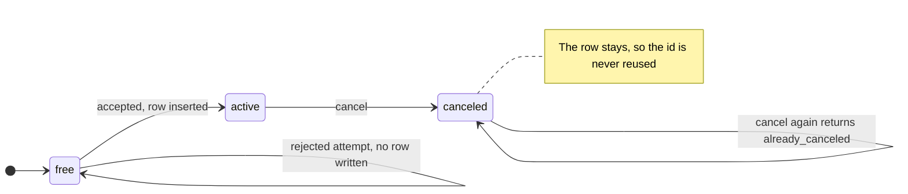
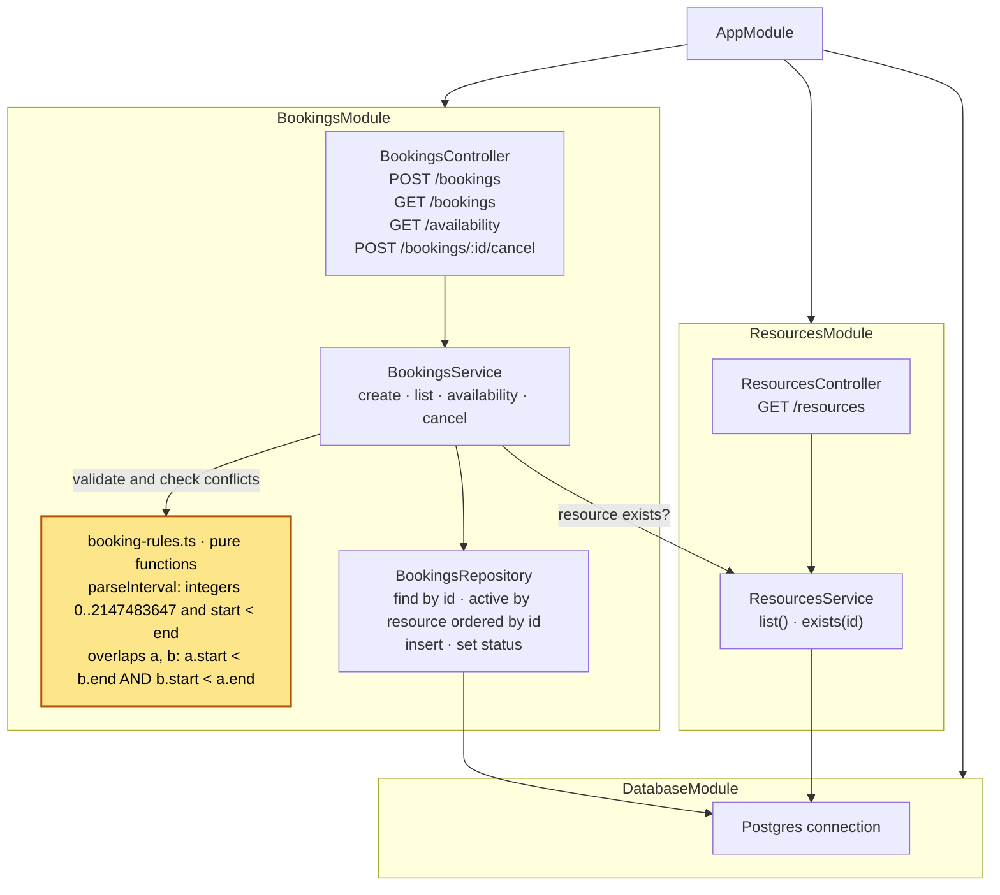
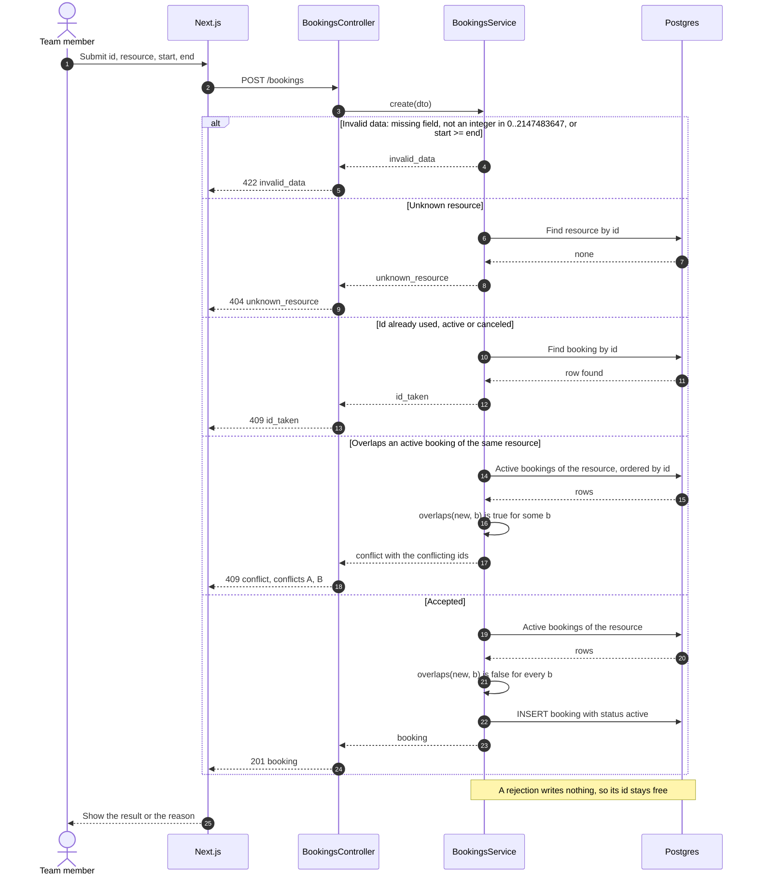
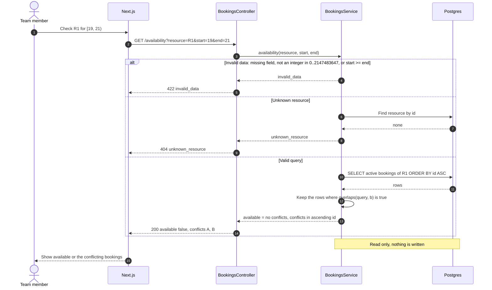
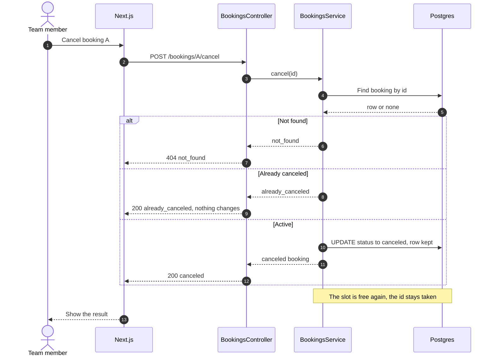

# Architecture diagrams: conflict-free bookings

One shared picture of the bookings app before implementation. It covers how the pieces run locally, what is stored, where the booking rules live and how each operation ends. The rules come from the PRD in [`.issues/docs/PRD.md`](../../.issues/docs/PRD.md).

1. [Containers](#1-containers)
2. [Data model](#2-data-model)
3. [Backend modules](#3-backend-modules)
4. [Booking flows](#4-booking-flows)

## 1. Containers

Everything runs on the developer machine. Only Postgres runs in Docker.

## 2. Data model

The resources are a fixed list, seeded at startup. A booking id is chosen by the client, as in the PRD example (A, B, C).

How the id rules follow from the model:

- **A canceled booking keeps its id.** Cancel only sets `status = canceled`. The row is never deleted, so the primary key keeps the id taken.
- **A rejected attempt does not take an id.** Every check runs before the `INSERT`. A rejection writes no row, so the same id can be used again (the PRD's second attempt at `C`).
- **Overlap only counts active bookings of the same resource.** Two bookings on different resources, or one canceled booking, never conflict.

The lifecycle of one booking id:

## 3. Backend modules

The `[start, end)` rule lives in one pure function, `overlaps()`, which `BookingsService` calls for both create and availability. The controllers only map HTTP to service calls and results to status codes.

## 4. Booking flows

Error codes: `unknown_resource`, `invalid_data`, `conflict`, `id_taken`, `already_canceled` and `not_found`. `id_taken` is the rejection that keeps an id taken after it was used once.

### 4.1 Create a booking

### 4.2 Check availability

The query never writes. Conflicts come back in ascending id order.

### 4.3 Cancel a booking

